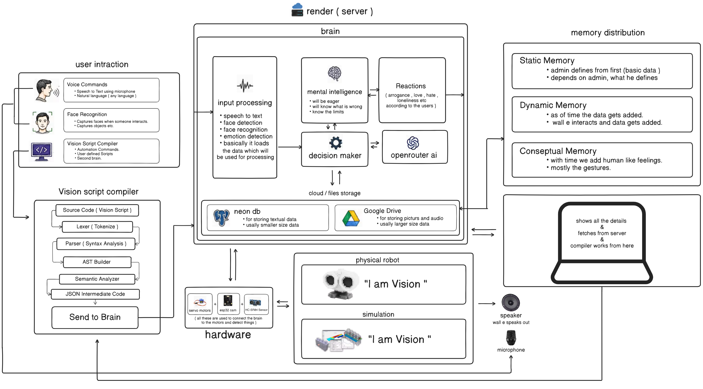

<p align="center">
  <a>
    
  </a>
</p>
<p align="center">
 a robot with real human intelligence, consisting of memory and emotions like a real human.
</p>

<p align="center">
  <a href="#setup"></a>
  <a href="#setup"></a>
  <a href="#database"></a>
  <a href="#hardware"></a>
  <a href="#the-simulator"></a>
</p>


> **⚠️ Honest framing.** Vision is my final year scale robot with a real, persistent brain, not a product. Everything in the simulator runs without hardware, simulator endpoints are refused when the server is in `hardware` mode, so they can never touch the real robot. The optional AI features need an API key and have **not been tested against a real model in the build environment**: with no key, the robot falls back to its built-in local mind. The decision weights in the Autonomous mind are hand-tuned, not trained.


## Table of contents

1. [Setup](#setup)
2. [Using Vision](#using-vision)
3. [Hardware](#hardware)
4. [How the hardware works](#how-the-hardware-works)
5. [Architecture](#architecture)
6. [The simulator](#the-simulator)
7. [Adding 3D objects to the simulator](#adding-3d-objects-to-the-simulator)
8. [The Autonomous mind](#the-autonomous-mind)
9. [Memory and teaching](#memory-and-teaching)
10. [Database](#database)
11. [Authentication](#authentication)
12. [Services and endpoints](#services-and-endpoints)
13. [Control mode and Vision Script](#control-mode-and-vision-script)
14. [Testing](#testing)


## Setup

You need **Node 18+** and a free [Neon](https://neon.tech) Postgres database (a local Postgres with the **pgvector** extension also works).

```bash
# 1. install both projects and create .env from .env.example
npm run setup

# 2. create the tables: Neon SQL Editor -> paste database/schema.sql -> Run
#    then put the connection string in DATABASE_URL (server/.env)

# 3. optional starter data: 3 servos, default gait, static memory
npm run seed

# 4. run
npm run dev:server      # http://localhost:4000
npm run dev:dashboard   # http://localhost:5173
```

Open **http://localhost:5173**, register, then open the simulator at **http://localhost:4000/simulation/**.

| Robot mode (chosen on the dashboard; `ROBOT_MODE` in `server/.env` is only the starting value) | Result |
|---|---|
| Robot page → **Simulation** (default) | Brain and compiler drive a virtual robot you watch in 3D. No hardware needed |
| Robot page → **Real robot** | The same brain drives the real ESP32 over a WebSocket. Simulator endpoints answer `409` |
| No `DATABASE_URL` | Server cannot start |
| No AI key | Everything works; open questions get a built-in fallback reply |
| `JAMENDO_CLIENT_ID` set | Voice view plays full-length tracks; otherwise 30-second iTunes previews |

There is no built-in admin login. Create admins with `node scripts/create-admin.js` 


## Using Vision

The dashboard sidebar:

| Page | What happens |
|---|---|
| **Monitoring / Robot / Telemetry** | Live robot state and sensor data |
| **Camera / Tracking** | Live camera view and person tracking |
| **Audio** | Speech and microphone |
| **Ultrasonic** | Distance sensor and safety thresholds |
| **People / Objects** | Who and what Vision knows, with profile pages |
| **Memory Lookup** | Ask the memory chain a question and see which tier answered. Admins teach facts here |
| **Brain / Mental / Decisions / Reactions** | Inspect how the robot thinks and reacts |
| **Tasks / Commands** | Task list and manual commands |
| **Eye / Leg / Gait control** | Direct hardware control (blocked in simulation mode) |
| **Simulation** | Opens the three simulator views |
| **Compiler** | Admin writes a Vision Script and compiles it for the simulator |
| **Logs / Safety / Settings / Users** | Logs, emergency stop, settings and user roles |

**Things to try**

- Open the simulator, switch to **Autonomous**, and watch him decide for himself. Press **Praise** or **Scold** and see his mood change.
- Click **Teach my face**, type your name, and he remembers you separately from other people.
- In **Voice**, say "Vision, play Despacito". He finds the song, asks why you like it, and "next song" plays the next result.
- On **Memory Lookup**, add a fact as an admin, restart the server, and ask again: it is still there.


## Hardware

| Part | Qty | Role |
|---|---|---|
| OceanLabz ESP32-S3 WROOM N16R8 | 1 | The brain's body: Wi-Fi, camera, I2S audio, servo bus (16 MB flash, 8 MB octal PSRAM) |
| OV3660 camera module | 1 | Eyes |
| PCA9685 PWM driver (I2C `0x40`) | 1 | Drives all three servos |
| Servo, positional | 1 | **CH0 head**, 0-180°, 90° = straight ahead. Carries the camera and the HC-SR04 |
| Servo, continuous rotation | 2 | **CH1 left leg**, **CH2 right leg** |
| INMP441 I2S microphone | 1 | Ears |
| I2S DAC/amp (e.g. MAX98357A) + 4 Ω 3 W speaker | 1 | Voice |
| HC-SR04 ultrasonic sensor | 1 | Obstacle detection, mounted on the head next to the camera |

No separate ESP32 DevKit and no TT gear motors. Channels CH3-CH15 on the PCA9685 are unused. 

> **Never wire the HC-SR04 Echo pin straight to a GPIO.** It outputs about 5 V and the ESP32 is 3.3 V. Use a 1 kΩ / 2 kΩ divider or a level shifter.


## How the hardware works

| Component | How it works |
|---|---|
| **ESP32-S3** | The only computer on the robot. It captures camera frames, reads the sensor, plays audio and moves the servos. It does not think: it sends frames and sensor data to the server and carries out the commands that come back. No database or API keys are stored on it |
| **Camera (OV3660)** | Takes JPEG frames at a cadence the server sets and re-sends with each frame result. Frames go to the server as raw binary over the WebSocket. The server runs person and object recognition on them |
| **PCA9685** | A 16-channel PWM chip the ESP32 talks to over I2C (SDA GPIO1, SCL GPIO2). It generates the servo signals so the ESP32 does not have to. The servos need their own 5-6 V supply with a common ground |
| **Head servo (CH0)** | A positional servo: you give it an angle and it goes there, easing at about 240°/s. Looking around only moves the head, so he can look while he walks |
| **Leg servos (CH1, CH2)** | Continuous-rotation servos: you set speed and direction, not an angle. Forward drives both the same way, turning drives them in opposite ways. Gait is a short list of timed phases per command. If a leg is mounted as a mirror image, set `LEFT_LEG_INVERTED` or `RIGHT_LEG_INVERTED` in `servo_config.h` |
| **HC-SR04** | Sends a 10 µs pulse on TRIG (GPIO41) and times the echo (GPIO42): `distance = echo_µs / 58` cm. A 5-sample median+mean filter smooths it. States: CLEAR (>600 mm), NEAR (300-600), WARNING (150-300), OBSTACLE (50-150), VERY_CLOSE (≤50), INVALID |
| **Movement safety** | Walking is allowed only when the state is CLEAR or NEAR **and** the head is facing forward (the sensor is on the head). If the head is turned away, only a recent forward reading counts, and only for 800 ms. The server brings the head forward before it drives the legs. The firmware checks the same rule, so neither side can bypass it alone |
| **Microphone (INMP441)** | Streams audio over I2S (SCK 40, WS 38, SD 39). The server turns it into text, works out the intent and replies |
| **Speaker + amp** | The server sends speech or music as raw 16-bit audio in 4 KB chunks over the WebSocket. The amp module (DOUT 21, BCLK 47, LRC 48) plays it. The bare speaker is never wired to a GPIO |
| **Link to the server** | One persistent WebSocket, `wss://<server>/api/robot-ws`, authenticated with a robot secret. Commands are pushed the instant they are dispatched. HTTP polling is the fallback |
| **On-device protections** | Timed moves stop themselves on the robot even if the follow-up stop is lost. A watchdog stops the legs if nothing is heard from the server for a set time. A hardware emergency stop always works |


## Architecture

   

## The simulator

Open `http://localhost:4000/simulation/`. It is a 3D robot (the shared `robot.obj` model) in a sandbox. Nothing here reaches the real robot.

| View | What it does |
|---|---|
| **Compiler** | Plays the program you compiled on the dashboard's Compiler page. The simulator has no editor of its own |
| **Autonomous** | He decides for himself. Camera and microphone toggles, stimuli (praise, scold, poke, loud noise, drop a toy, teleport), teach a face, forget me, reset memory, time speed, day length, a human-like on/off switch |
| **Voice** | Talk to him with the wake word "Vision". Built-in commands (dance, walk, stop, play music) need no AI. Other questions go to the AI with silent fallback between models |


## Adding 3D objects to the simulator

Objects in the **Autonomous** view are listed in one file: **`server/simulation/autonomous/scenery.json`**. The arena now starts **empty**. Place things by hand in **Lab → Map** (click a spot, pick a shape, press Place; drag to move). What you place is saved in your browser and survives a reload. You can also list objects in this file as a starting layout, and copy your Lab layout back into it with “Copy as scenery.json”.

```json
{
  "objects": [
    { "id": "crate",  "shape": "box",      "x": 12,  "z": -14, "size": 2.5, "color": "#b45309", "known": true },
    { "id": "pillar", "shape": "cylinder", "x": -18, "z": 8,   "size": 5,   "color": "#64748b", "known": true },
    { "id": "cone",   "shape": "cone",     "x": 4,   "z": 24,  "size": 3,   "color": "#f97316", "known": true }
  ]
}
```

| Field | Meaning |
|---|---|
| `id` | Unique name |
| `shape` | Built-in shape: `box`, `cylinder`, `sphere` or `cone` (no file needed) |
| `url` | **Instead of `shape`**: a `.glb` / `.gltf` model, e.g. `"../assets/models/tree.glb"` (put the file in `server/simulation/assets/models/`) |
| `x`, `z` | Position in **robot-sizes**. He starts at `0, 0`. `x` is right, `z` is forward. Use different values to put objects in different places |
| `size` | Height in robot-sizes |
| `color` | Hex colour for built-in shapes |
| `rotY` | Rotation around the vertical axis, in radians |
| `solid` | `true` (default): he walks around it |
| `known` | `true`: he can see it, talk about it ("I can see the box on my right") and walk to it |

You can also add one from the browser console while the page is open:

```js
await vision.addScenery({ id: "ball", shape: "sphere", x: 8, z: 6, size: 2, color: "#22c55e", known: true })
```

To use your own model, drop a `.glb` into `server/simulation/assets/models/` and reference it with `url`. The model is scaled to `size` and sits on the floor. The Lab map shows exactly where each object is relative to him.

The Compiler view has its own separate scene and does not read `scenery.json`.


## The Autonomous mind

He chooses his own actions with plain maths, not an AI. An optional AI only words the speech.

1. **Feelings** (mood, arousal, curiosity, social need, boredom, fatigue, plus a simulated hormone system) are updated every tick.
2. Each of 9 actions (wander, look around, dance, rest, call out, murmur, go home, play, watch) gets a **base score** from those feelings.
3. Adjustments are added: hormones, active goals, mood, fatigue, reading the person's mood, the emotional brain's instinct, what worked before (overall and in this exact situation), recent memories, and a penalty for repeating himself.
4. The **human like layer** adds: a body clock with sleep, personality traits, hurt feelings toward a specific person, and no talking over you.
5. A **multi step plan** (for example "play with the toy, then show it to you") is followed first if one is active.
6. Otherwise he keeps his current intention while it still scores well, or picks by **softmax**: `weight = exp((score - best) / T)`, with `T` between 0.06 and 0.32. He commits for 4-12 seconds so he does not twitch.
7. After acting, a reward updates what he has learned works.

The human-like layer in short:

- **Body clock:** a simulated 24-hour day (6 min, 12 min, 24 min or 1 hour of real time). He gets sleepy, sleeps at night, wakes groggy if disturbed.
- **Relationships:** per person, by face. Trust, warmth and grudges. Scold him and he sulks until you apologise; grudges halve every 10 minutes.
- **Personality:** five traits that drift slowly with experience.
- **Mood carries over:** a bad evening gives a gloomier morning.
- **Long term goals:** explore eight new corners, learn two things about you, or have six conversations. He mentions progress and celebrates.
- **Saved mind:** all of this is stored per user in Postgres (`/api/simulation/mind-state`), so it follows you across devices. If the database is down, the browser copy is used.
- **Forget me / Reset memory** buttons erase one person or everything.


## Memory and teaching

Lookup order: **static facts, then verified learned facts, then conceptual memory, then the AI** as a last resort. The Memory Lookup page shows which tier answered and why.

Admins teach Vision on the Memory Lookup page:

- Add, edit and delete facts, with tags.
- **Import many** at once, one per line: `Title | Content | tag`. Lines starting with `#` are ignored.
- Facts an admin teaches are trusted immediately. Facts the AI learned on its own wait for **Verify** or **Reject**.
- Everything is saved in Postgres and reloaded when the server starts.


## Database

PostgreSQL with the **pgvector** extension, which is **required** (face search). Neon has it built in; on a self-hosted Postgres install the pgvector package first, or `database/schema.sql` stops at `CREATE EXTENSION vector`.

| Step | What to do |
|---|---|
| 1 | Create a free project at [neon.tech](https://neon.tech) |
| 2 | Paste `database/schema.sql` into the SQL Editor and run it. It creates every table, including `simulation_mind_state` |
| 3 | Copy the connection string into `DATABASE_URL` |

Migrations live in `database/migrations/`. The seed script (`npm run seed`) is safe to run repeatedly. See `database/README.md`.


## Authentication

| Role | Can do |
|---|---|
| `USER` | Default for new registrations |
| `TRUSTED` | Can use the simulator. Promoted by an admin from the Users page |
| `ADMIN` | Everything, including teaching facts and the Compiler page |

Registration has an optional webcam step: if you have met Vision before, your account links to the same face identity. Roles are enforced server side on every protected route. Login has a Remember-me option. 


## Services and endpoints

| Service | URL | Purpose |
|---|---|---|
| Server + API | http://localhost:4000 | REST API, WebSocket, simulator pages |
| Dashboard | http://localhost:5173 | React dashboard |
| Simulator | http://localhost:4000/simulation/ | Compiler / Autonomous / Voice views |
| Health | `/api/system/health` | Deployment health check |

Simulator and memory endpoints (all refused in hardware mode where they touch the simulator):

| Endpoint | Role | Purpose |
|---|---|---|
| `POST /api/simulation/voice/chat` | TRUSTED | Voice view: commands, music, AI replies |
| `GET/PUT/DELETE /api/simulation/mind-state` | TRUSTED | Saved Autonomous mind for the logged-in user |
| `POST /api/simulation/consciousness/think` | TRUSTED | Optional AI wording of his speech |
| `POST /api/memory/search` | logged in | Memory lookup with trace |
| `POST /api/memory/learn`, `/static`, `/bulk` | ADMIN | Teach facts |
| `PUT /api/memory/static/:key`, `/dynamic/:id` | ADMIN | Edit facts |
| `POST /api/memory/dynamic/:id/verify`, `/reject` | ADMIN | Review AI-learned facts |


## Control mode and Vision Script

| Mode | Behavior |
|---|---|
| **AUTONOMOUS** (default) | The brain perceives, decides and acts on its own |
| **MANUAL** | A human drives via the dashboard's Eye/Leg/Gait controls or Vision Script |

STOP, CENTER, SAFE and Emergency Stop work in either mode. Vision Script is a small, safe, line-based language (never arbitrary JavaScript); loops and expressions are resolved at compile time.

| Line | What it does |
|---|---|
| `EYE_CENTER` | Centres the head |
| `WALK_FORWARD 1000` | Walks forward for 1000 ms |
| `TURN_LEFT 300` | Turns left for 300 ms |
| `DANCE 20000` | Dances for 20 s |
| `FIND_PERSON "Sam"` | Starts a search for Sam |
| `AUDIO_SPEAK "Hello"` | Speaks the text |
| `REPEAT 4 TIMES ... END` | Bounded loop |


## Testing

```bash
npm test
```

| Area | Covered |
|---|---|
| Perception | Person tracking (left, right, centred, lost) |
| Movement | Continuous and positional servo control, gait phases |
| Safety | Emergency stop, authorization, role hierarchy |
| Memory | Priority chain, teaching routes (against a fake and a real Postgres), restart persistence |
| Simulator | Voice commands and music, the human-like mind (clock, plans, relationships, goals), saved-mind routes |
| Compiler | Kill-switch default, valid and invalid Vision Script |
